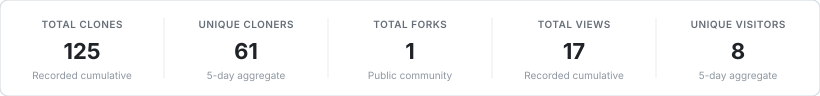

# Intelligent Data Systems

Practical solutions, lab experiments, and reference implementations for Semester 5 Intelligent Data Systems.

<!-- REPOSITORY_ANALYTICS_START -->
### Repository Insights

  

  

### Hall of Appreciation

<table align="center">
  <tr>
    <td align="center" width="160">
      <a href="https://github.com/abhi220705">
         
        <b>@abhi220705</b>
      </a> 
      Community Fork
    </td>
  </tr>
</table>
<!-- REPOSITORY_ANALYTICS_END -->

---

### Support the Project

If you find this repository helpful, consider starring the repository and following [@shivampimple29](https://github.com/shivampimple29) on GitHub.
