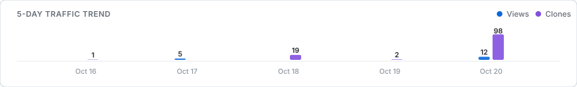

<!-- REPOSITORY_ANALYTICS_START -->
# 📊 Repository Analytics & Traffic Dashboard

> **Automated Insights** for [shivampimple29/Intelligent-Data-System-sem5](https://github.com/shivampimple29/Intelligent-Data-System-sem5)  
> *Last Successful Update:* `2026-10-21 23:20:34 IST` | *Reporting Window:* `Building history` (0/5 days tracked)

> [!NOTE]
> **Traffic API Authentication Setup:** GitHub requires `Administration: Read` access for private clone & view statistics. Please configure the repository secret `GH_TRAFFIC_STATS_TOKEN` with a fine-grained Personal Access Token to enable automatic daily traffic collection.

### 🚀 Key Performance Indicators

---

### 📈 Daily Traffic Trends (Rolling 5-Day Window)

| Date (UTC) | Clones | Daily Unique Cloners | Views | Daily Unique Visitors | Status |
|:---|:---:|:---:|:---:|:---:|:---:|
| *No records yet* | 0 | 0 | 0 | 0 | In Progress |

**Period Growth & Cumulative Totals:**
- **5-Day Clones Growth:** `Baseline period (accumulating 10-day history)`
- **5-Day Views Growth:** `Baseline period (accumulating 10-day history)`
- **Recorded Cumulative Clones:** `0` events since tracking began
- **Recorded Cumulative Views:** `0` page views since tracking began

#### Daily Traffic Visualizer

  

---

### 🌟 Repository Growth & Community Overview

| Stars ⭐ | Forks 🍴 | Open Issues 🎯 | Open PRs 🔀 | Public Forks (Last 5 Days) | Recent Public Stars |
|:---:|:---:|:---:|:---:|:---:|:---:|
| 0 | 1 | 0 | 0 | 1 | 0 |

---

### ⚡ Verifiable Public Activity Feed

| Event | Contributor | Details | Date (IST) |
|:---|:---|:---|:---|
| **Commit 📦** | [shivampimple29](https://github.com/shivampimple29) | [`6be2a15`](https://github.com/shivampimple29/Intelligent-Data-System-sem5/commit/6be2a1559c7fa07a642dd093a32325b7d6486e14) feat(analytics): implement automated GitHub repository analytics dashboard | 2026-10-21 23:17 IST |
| **Commit 📦** | [shivampimple29](https://github.com/shivampimple29) | [`3c9dc56`](https://github.com/shivampimple29/Intelligent-Data-System-sem5/commit/3c9dc5631b0466498c707a740db9d9b3c14bf683) Add Q11 Solution | 2026-10-21 23:15 IST |
| **Commit 📦** | [shivampimple29](https://github.com/shivampimple29) | [`5c3cb49`](https://github.com/shivampimple29/Intelligent-Data-System-sem5/commit/5c3cb496ecd7d4d971ceb33a780470d58f9d9ffc) Add Q13 Solution | 2026-10-21 22:52 IST |
| **Commit 📦** | [shivampimple29](https://github.com/shivampimple29) | [`382f19a`](https://github.com/shivampimple29/Intelligent-Data-System-sem5/commit/382f19adbdc4f239f64383efb68232fa92a857f7) Add Q12 Solution | 2026-10-21 21:24 IST |
| **Commit 📦** | [shivampimple29](https://github.com/shivampimple29) | [`44b0d42`](https://github.com/shivampimple29/Intelligent-Data-System-sem5/commit/44b0d42b99b5d15a3979d156a216e9406353f6f2) Mock_Practical_Solutions/Q11.ipynb | 2026-10-21 20:31 IST |
| **Public Fork 🍴** | [abhi220705](https://github.com/abhi220705) | Forked repository to [abhi220705/Intelligent-Data-System-sem5](https://github.com/abhi220705/Intelligent-Data-System-sem5) | 2026-10-20 23:32 IST |

---

### ℹ️ Data Freshness & Pipeline Governance
- **Execution Schedule:** Automatically updated daily via GitHub Actions at 01:17 UTC (~06:47 AM IST) and upon direct push to `main`.
- **Timezone Conventions:** Daily traffic buckets correspond to GitHub API's official UTC 24-hour periods. Timestamps and display dates are presented in Indian Standard Time (`Asia/Kolkata`, UTC+05:30).
- **Metric Definitions:**
  - *Daily Unique Cloners / Visitors:* The count of distinct individual accounts/IPs reported by GitHub for that specific calendar day. GitHub's API specifications state that summing daily uniques across multiple days does **not** represent distinct individuals across the whole period.
  - *Cumulative Totals:* Persistent summation of recorded daily counts since historical collection began.
  - *Privacy Guarantee:* GitHub's traffic endpoints provide strictly aggregate, anonymous counts. Cloners and visitors are never individually identified or correlated with other public activity.
<!-- REPOSITORY_ANALYTICS_END -->

## Copyright

Copyright © 2026 Shivam S. Pimple. All rights reserved.

This repository is created for educational and reference purposes.
You may view the contents for learning and reference, but please do not
claim, copy, redistribute, or present this work as your own.

### ⭐ Support the Project

If you find this repository useful, please consider **starring ⭐ the repository**
and **following me on GitHub** for more projects and updates.

Your support is appreciated!
